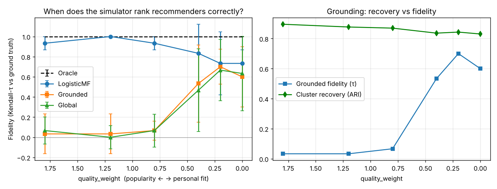

# Preliminary Findings

*Semi-synthetic world (2000 users, 1000 items, 6 latent clusters), 4-seed means.
All numbers are Kendall-τ between a simulator's recommender ranking and the
ground-truth ranking over a 6-model suite.*

## Setup recap
We rank a suite of recommenders (Random → Popularity → GenreMatch → MF-BPR×3)
two ways: by **true** expected engagement (oracle, from hidden factors) and by
each **agent simulator** (from logs only). Fidelity = how well the simulator's
ranking matches ground truth.

## Result 1 — Oracle sanity check passes
Using true utility, τ = 1.00 at every setting. The evaluation harness is correct.

## Result 2 — Per-user modeling is what drives fidelity
`LogisticMF` (per-user latent click model) reaches τ = 0.73–1.00 across regimes
and is the only non-oracle simulator that ranks recommenders reliably. Its edge
**grows** as engagement becomes less popularity-driven (higher `quality_weight`).

## Result 3 — Persona grounding does *not* help over a global model
`Grounded` ≈ `Global` at every `quality_weight` (e.g. 0.60 vs 0.63 at qw=0;
0.07 vs 0.07 at qw=0.8). This holds even though the grounded agent recovers the
true segments well (**ARI ≈ 0.83–0.90**). Recovering *who the segments are* does
not make a segment-level click model a faithful evaluator of *personalized*
recommenders.

## Result 4 — Segment recovery is decoupled from fidelity
ARI stays ~0.85 across the whole sweep while grounded fidelity swings with the
regime. High cluster-recovery ≠ high simulator fidelity.

## Interpretation
For **behavioral diversity** (QA personas, surfacing varied failure modes),
segment-level personas are valuable. For **ranking personalized recommenders by
engagement**, they are insufficient — the simulator must model individuals.
This refines, rather than contradicts, the persona-grounding literature: the
right granularity depends on the downstream task.

## Caveats (what a reviewer would flag, and the plan)
- Single world family, small scale, 4 seeds — trends are clear but CIs are wide.
- The 6-model suite has near-ties (MF variants), which Kendall-τ penalizes;
  add a wider-spread suite and report pairwise accuracy alongside τ.
- **Open question / next experiment:** sweep `cluster_spread`. At spread→0 (tight
  segments, segment identity = full preference), grounded personas *should*
  approach LogisticMF. If so, the clean claim is: *"persona grounding suffices
  only when within-segment heterogeneity is small; realistic heterogeneity
  requires per-user modeling."*
- External validity: port to **MovieLens** (adapter, Phase 5) and check the same
  ladder holds on real behavior.
